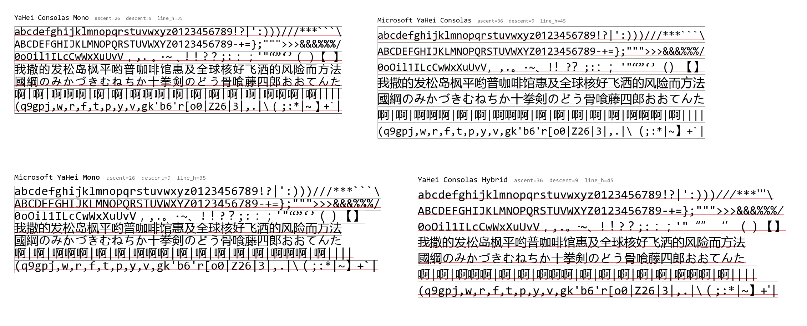

# YaHei Consolas Mono — 字体修改说明

本文档说明对 `Microsoft YaHei Consolas` 的修改目的、方案、明细与验证结果。

---

## 1. 背景与目的

[原字体](https://github.com/byzod/Microsoft-Yahei-Consolas)是 Consolas（西文等宽）与微软雅黑（CJK）的合并字体，中英文宽度比例为 **1:2**（半角 advance = 1024，全角 advance = 2048，unitsPerEm = 2048）。

> 原字体修改自[Microsoft-Yahei-Mono](https://github.com/chenyium/Microsoft-Yahei-Mono)，一切版权归原作者……不对，归微软所有🥵
> 很多人都没注意consolas的字宽是1126，而雅黑全宽字是2048

存在的问题：**行高明显高于原版英文字体 Consolas**，中文混排时行距过大，与西文编辑体验不一致。

修改目标：

- 行高降至与原版 Consolas 一致（**2398 = 1.171em**）；
- 保持中文/英文宽度严格 **1:2**；
- 中文字形等比缩小并居中，任何渲染路径下**零裁剪**；
- 原有半角（Consolas）字形坐标完全不动；
- 补齐原合并字体缺少的常用标点/符号，同时保留 Unicode 明确的宽字符为全宽。

最终效果：


---

## 2. 原字体的问题分析

### 2.1 行高为什么比原版 Consolas 高

原合并字体整套垂直度量（`hhea` / `OS/2` / `head`）直接沿用了**微软雅黑**的数值，而不是 Consolas 的：

| 度量                             | 原版 Consolas                 | 原合并字体          | 修改后             |
| -------------------------------- | ----------------------------- | ------------------- | ------------------ |
| hhea.ascent / descent / lineGap  | 1521 / −527 / 350             | **2167 / −536 / 0** | 1521 / −527 / 350  |
| hhea 行高                        | **2398 (1.171em)**            | **2703 (1.320em)**  | **2398 (1.171em)** |
| OS/2 sTypoAscender/Descender/Gap | 1521 / −527 / 350             | 1663 / −519 / 9     | 1521 / −527 / 350  |
| OS/2 usWinAscent / usWinDescent  | 1884 / 514                    | **2167 / 536**      | 1884 / 514         |
| fsSelection                      | 0x0040（无 USE_TYPO_METRICS） | 同左                | 同左               |

两个字体均未设置 `USE_TYPO_METRICS`，因此 Windows GDI、终端、多数编辑器按 `usWinAscent + usWinDescent`（或 hhea）排版：

- 原版 Consolas 行高 = 1884 + 514 = **2398**；
- 原合并字体行高 = 2167 + 536 = **2703**，**高出 305 单位 ≈ 12.7%**。

**为什么必须用这么大的度量？** 雅黑 CJK 字形垂直范围是 **−521 … 2108**（全角方块设计，占满 em 盒；`中` 为 −277…1707，最高字形达 2108）。若沿用 Consolas 的 winAscent = 1884，最高 2108 的字形顶部会被裁掉 224 单位（≈0.11em）。雅黑把 winAscent 定为 2167（> 2108）正是为了保证不裁剪。因此"中文不被裁剪"与"行高紧凑"必须取其一，原字体选择了前者。

### 2.2 宽度比例（1:2 正常）

拉丁字形 advance = 1024（半宽），CJK = 2048（全宽），比例正确，无需修改宽度。

---

## 3. 修改方案

1. **等比缩放全部全角（雅黑）字形**：按比例 0.9121 缩小，横向居中到全角格；
2. **垂直度量改回原版 Consolas 数值**，使行高 = 2398；
3. **补齐 DejaVu Sans Mono 中缺失的标点/符号**：只处理 Unicode 类别 `P*`/`S*`，不混入阿拉伯文、格鲁吉亚文等其他文字脚本；
4. **按 Unicode East Asian Width 处理补入符号的单元格宽度**：`W`/`F` 使用全宽 2048，其余使用半宽 1024；
5. **删除失效的 hinting 与竖排表**；
6. **把残留的 0.6em（1229）比例符号归一到 1024 半角格**：14 个块元素 + 9 个几何图形；
7. **把块元素的纵向盒子统一到整格 [−514, 1884]**：四个来源的原始盒子高度从 2180 到 2482 不等；
8. **声明 duospaced**：`post.isFixedPitch=1`、`OS/2.panose.bProportion=9`，与上游及同类 CJK 等宽字体一致；
9. **写入版本与厂商标识**：`head.fontRevision`、`name` ID 3/5/8/11、`OS/2.achVendID`；
10. **重命名字体族**，避免与已安装的同名字体冲突。

---

## 4. 修改明细

### 4.1 字形缩放

- 缩放对象：advance = 2048 的全角字形，共 **28,874 个**（总字形 31,450，原有半角字形不动）；
- 缩放前全角字形垂直范围：**[−521, 2108]**；
- 缩放比例：**s = 2398 / 2629 ≈ 0.912134**（等比，横纵同比例）；
- 垂直位移：**dy = −38.778**（线性映射 y′ = s·y + dy，把 [−521, 2108] 映射到 **[−514, 1884]**）；
- 横向：以字形原中心为锚等比缩放后平移居中，`dx = 1024 − s·cx`，使字形在 0–2048 全角格内左右对称；
- advance 宽度保持 2048 不变，**1:2 宽度比不受影响**；
- 原有半角（Consolas）字形（如 A、g、ASCII 标点）坐标**逐点不变**。

示例：`中`

|        | 原字体       | 修改后                      |
| ------ | ------------ | --------------------------- |
| x 范围 | [168, 1888]  | [240, 1808]（左右对称留白） |
| y 范围 | [−277, 1707] | [−291, 1518]                |

### 4.1.1 从 DejaVu Sans Mono 补齐缺失的标点/符号

原合并字体和本字体都没有覆盖一部分终端常用符号，例如：

```text
❯  U+276F  HEAVY RIGHT-POINTING ANGLE QUOTATION MARK ORNAMENT
➜  U+279C  HEAVY ROUND-TIPPED RIGHTWARDS ARROW
```

构建脚本从本机 DejaVu Sans Mono 读取目标字体缺失的 Unicode 码点：

- 只补入 Unicode 类别 `P*`（标点）和 `S*`（符号）；
- 差集共 821 个码点，其中 `U+FFFC OBJECT REPLACEMENT CHARACTER` 没有可见轮廓，因此跳过；
- 最终补入 **820 个可见码点/字形**；
- 不补入 DejaVu 中额外的阿拉伯文、老挝文、格鲁吉亚文等其他文字脚本；
- DejaVu Sans Mono 与本字体都使用 `unitsPerEm = 2048`，补入字形不需要做单位换算。

补入符号的宽度按 Unicode East Asian Width 处理：

| East Asian Width | 数量 | 本字体 advance | 处理 |
| ---------------- | ---- | --------------- | ---- |
| `W` / `F`        | 19   | 2048            | 全宽 |
| `N` / `Na` / `A` | 801  | 1024            | 半宽 |

`A`（Ambiguous，模糊宽度）在代码编辑器和终端场景中按单列半宽处理，避免数学符号在普通终端中突然占用两列。

典型结果：

| 字符 | Unicode | East Asian Width | advance | glyph bbox（units） |
| ---- | ------- | ---------------- | ------- | ------------------- |
| `❯`  | U+276F | N                | 1024    | `[174, −159, 848, 1295]` |
| `➜`  | U+279C | N                | 1024    | `[60, 295, 962, 1060]` |
| `☕`  | U+2615 | W                | 2048    | `[130, 12, 1918, 1376]` |
| `⚡`  | U+26A1 | W                | 2048    | `[226, 13, 1822, 1283]` |

每个补入 glyph 都会根据其目标单元格横向缩放并居中；宽度较大的框线/数学符号还会额外缩小，确保 TrueType bbox 不超过 `0..advance`。补入集合的垂直范围会统一适配到 `−514..1884`，避免被新的 winAscent/winDescent 裁剪。

### 4.2 垂直度量（改为原版 Consolas 数值）

| 表   | 字段                                          | 原值            | 新值                  |
| ---- | --------------------------------------------- | --------------- | --------------------- |
| hhea | ascent / descent / lineGap                    | 2167 / −536 / 0 | **1521 / −527 / 350** |
| OS/2 | sTypoAscender / sTypoDescender / sTypoLineGap | 1663 / −519 / 9 | **1521 / −527 / 350** |
| OS/2 | usWinAscent / usWinDescent                    | 2167 / 536      | **1884 / 514**        |
| head | yMin / yMax（重算）                           | −648 / 2108     | **−648 / 2036**       |
| head | xMin / xMax（重算）                           | −936 / 2050     | **−936 / 2010**       |

修改后行高 = 1521 + 527 + 350 = **2398（1.171em）**，与原版 Consolas 完全一致。

### 4.3 删除的表与指令

| 项目                                               | 原因                                                                  |
| -------------------------------------------------- | --------------------------------------------------------------------- |
| `fpgm` / `prep` / `cvt`（字体级 TrueType hinting） | 指令基于原坐标编译，缩放后失效                                        |
| 全部字形的 hinting 指令（`program`）               | 同上；原有 28,874 个缩放字形及 176 个原有半角字形的指令被清除；新增补字不带指令 |
| `vhea` / `vmtx`（雅黑竖排度量）                    | 缩放后坐标错位；原版 Consolas 无此表，终端场景用不到                  |

### 4.4 字体命名

| 字段                        | 原值                             | 新值                                     |
| --------------------------- | -------------------------------- | ---------------------------------------- |
| family / typographic family | Microsoft YaHei Consolas         | **YaHei Consolas Mono**                  |
| full name                   | Microsoft YaHei Consolas Regular | **YaHei Consolas Mono**（单字重，不拼 Regular） |
| postscript name             | —                                | YaHeiConsolasMono                        |

改名的两个原因：

1. **避免与已安装的上游同名字体冲突**——字体族必须唯一，否则两份 `Microsoft YaHei Consolas` 会互相覆盖；
2. **`Compact` 是宽度/设计修饰词，不是用途描述**——留下来会让人以为还存在一个非 Compact 的同族版本。`Mono` 直接说明这是等宽编码字体，与 `Sarasa Mono SC`、`Cascadia Mono`、`Maple Mono NF CN` 的命名惯例一致。

本字体是**单字重家族**：`name` ID 2 仍是 `Regular`（RIBBI 必需，否则字体归类异常），但 full name 直接等于族名，菜单里显示为「YaHei Consolas Mono」而不是「YaHei Consolas Mono Regular」。没有 Bold 字体时，终端 ANSI bold 与编辑器语法高亮会由系统合成加粗（faux bold）。

### 4.5 半宽符号归一化（1229 → 1024）

上游雅黑把块元素与几何图形设计在 **0.6em = 1229** 的比例格位里，与本字体的 1024 半角格冲突：同一个码块里 1024 与 1229 并存，`▁▂▃▄` 这类进度条会在 1/4 处突然变宽；其中 14 个块元素的 bbox 还是 `[−23, 1251]`，左右各越出格位 23 单位。

处理方式：

- **块元素（U+2580–259F）**：按整组的联合 bbox 做一次仿射，让 `▁..▇`、`▉..▏` 共享同一格位。逐字形居中会让左竖条与右竖条互相错位，所以必须整组映射。
- **几何图形（U+25A0–25EF）**：轮廓宽度 865–946，本就在半角格内，等比（必要时缩小）后居中于 512。
- 只动横向；纵向由 4.6 单独处理。

| 组 | 处理前 | 处理后 |
| --- | --- | --- |
| 块元素 `▁▂▃▅▆▇▉▊▋▍▎▏▔▕` | advance 1229，bbox `[−23, 1251]` | advance **1024**，bbox `[0, 1024]`（`▉..▏` 左贴边、`▕` 右贴边） |
| 几何图形 `△▽◆◇◎◢◣◤◥` | advance 1229 | advance **1024**，轮廓未缩放，居中 |

**仍保留比例宽度的 31 个字形**（P1/P2 尚未处理）。构建脚本把它们列在 `KNOWN_OFFGRID_CODEPOINTS` 白名单里，除此之外出现任何非 `{0, 1024, 2048}` 的 advance 都会让构建失败：

| 类别 | 字符 | 宽度 |
| --- | --- | --- |
| 标点小符号 | `‧` `‵` `′` `ˉ` `‐` `‥` | 493 – 985 |
| 数学运算符 | `∣` `≌` `≦` `≧` `≮` `≯` `∮` `∠` `∴` `∵` `∧` `∨` `∽` `∥` `≒` `⊿` `⊕` `∶` `∷` `∝` | 1124 – 1806 |
| 其他符号 | `※` `★` `☆` `☉` `⅟` | 1638 – 1925 |

### 4.6 块元素纵向整格统一

同一个码块里的块元素来自四个源，纵向盒子各不相同，混排时高低不一；其中雅黑侧还超出 win 盒，会被严格按 `usWinAscent/Descent` 裁剪的渲染器切掉：

| 来源 | 字形 | 原始 y 范围 | 高度 |
| --- | --- | --- | --- |
| Consolas | `▀` `▄` `█` `▌` `▐` `▓` | −405 … 1775 | 2180 |
| 雅黑 | `▁▂▃▅▆▇▉▊▋▍▎▏▔▕` | −446 … 2036 | 2482 |
| 影线（自带下边距） | `░` `▒` | −316 … 1775 | 2091 |
| DejaVu 补入 | `▖▗▘▙▚▛▜▝▞▟` | −493 … 1872 | 2365 |

`░` `▒` 的顶边与 `▓` 相同、底边高 89 单位，是设计上的下边距；统一时按 Consolas 盒子等比映射，保留该特征。

处理方式：按各自来源盒子做纵向仿射，映射到 **整格 [−514, 1884]**（即 `usWinDescent … usWinAscent`，也是全角字形的范围），从而保持"1/8 阶""半块""象限"的相对语义。结果（整格高度 2398）：

| 字形 | y 范围 | 占整格 |
| --- | --- | --- |
| `▁` `▂` `▃` `▄` `▅` `▆` `▇` `█` | −514 … −214 / 85 / 385 / 685 / 985 / 1284 / 1584 / 1884 | 1/8 … 8/8 |
| `▀` | 685 … 1884 | 1/2 |
| `▔` | 1584 … 1884 | 1/8 |
| `▉` `▊` `▋` `▌` `▍` `▎` `▏` `▐` `▕` | −514 … 1884 | 满格 |
| `░` `▒` | −416 … 1884 | 0.96（保留下边距） |
| `▖` `▗` `▘` `▝` | −514 … 686 / 686 … 1884 | 1/2 |
| `▙` `▚` `▛` `▜` `▞` `▟` | −514 … 1884 | 满格 |

统一后 `head.yMax` 由 2108（原合并字体）降到 **1884**，落在 `[−514, 1884]` 之外的字形从 **69 个降到 44 个**（剩下的是拉丁组合附加符号，属上游既有情况，未重绘）。

### 4.7 等宽声明（duospaced）

`isFixedPitch = 1` 在 CJK 双宽字体里的实际语义是"**每个格位内部等宽**"，不是"所有字形同一个 advance"。上游与本机同类字体都是这么声明的：

| 字体 | 半角 / 全角 advance | 离格 advance | isFixedPitch | panose.bProportion |
| --- | --- | --- | --- | --- |
| Microsoft YaHei Mono（上游） | 1126 / 2048 | 17 种（含 1229 × 95 个） | 1 | 9 |
| Sarasa Mono SC | 500 / 1000 | 8 种（含 2000 / 3000） | 1 | 9 |
| Maple Mono NF CN | 600 / 1200 | 0 | 1 | 9 |
| Cascadia Next SC | 1024 / 2048 | 4 种（2045–2049 舍入残差） | 1 | 9 |
| **本项目** | **1024 / 2048** | **19 种（31 个比例符号）** | **1** | **9** |

生效范围要说清楚：

- **有效**：Linux 的 fontconfig / FreeType（`fc-match monospace` 能否选中、`spacing=mono` 属性）、部分 IDE 的"只列出等宽字体"筛选。
- **无效**：Windows GDI 的 `TMPF_FIXED_PITCH` 是由实测字符宽度推导的，不读 `post.isFixedPitch`；macOS CoreText 同样不依赖该字段。**因此声明本身不会改变任何渲染对齐**，对齐完全由 advance 网格决定。

### 4.8 版本与厂商标识

上游把这几个字段留在了 2022 年的一次 FontCreator 构建上，无法区分本仓库的任何改动：

| 字段 | 改前 | 改后 |
| --- | --- | --- |
| `head.fontRevision` | 6.25 | **1.001** |
| `name` ID 3（Unique ID） | `Microsoft YaHei Consolas:Version 6.250` | `YaHei Consolas Mono;1.001` |
| `name` ID 5（Version） | `Version 6.250;May 4, 2022;FontCreator 14.0.0.2814 64-bit` | `Version 1.001;build_compact_font.py (base 6.250)` |
| `name` ID 8（厂商） | `Microsoft Corporation` | `ruanimal` |
| `name` ID 11（厂商网址） | `microsoft.com/typography` | `github.com/ruanimal/Microsoft-Yahei-Consolas-Compact` |
| `OS/2.achVendID` | `"MS  "` | `"RUAN"` |

版权、商标、设计者、许可（`name` ID 0/7/9/10/13/14）保持上游原样。

版本号在脚本里是**单一真源**：

```python
FONT_VERSION = "1.001"    # 派生 head.fontRevision 与 name ID 3/5
BASE_VERSION = "6.250"    # 所基于的上游版本，写进 name ID 5 供追溯
```

递增规则：

| 变更类型 | 操作 |
| --- | --- |
| 改字形 / 度量 / 元数据 | `1.000` → `1.001`（次版本 +0.001） |
| 仅重建、内容不变 | 不变号（`head.modified` 会变） |
| 重新同步上游 | 主版本 +1（`2.000`），并更新 `BASE_VERSION` |

`verify_font()` 会校验 `head.fontRevision`、`name` ID 3/5、`achVendID` 三者一致，改漏任何一处都会让构建失败。版本字符串不含日期，所以同样的源码重建得到同样的版本号；需要知道构建时刻看 `head.modified`。

---

## 5. 验证结果

| 验证项                              | 原合并字体     | 修改后                           | 原版 Consolas  |
| ----------------------------------- | -------------- | -------------------------------- | -------------- |
| 行高（hhea / win）                  | 2703 (1.320em) | **2398 (1.171em)**               | 2398 (1.171em) |
| 34px 字号下实际行高（PIL/FreeType） | 45px           | **35px**                         | 35px           |
| 中文/英文宽度比                     | 2.000          | **2.000**                        | —              |
| 全角字形 y 范围                     | [−521, 2108]   | **[−514, 1884]**（win 内零裁剪） | —              |
| 原有半角字形                        | —              | 坐标未修改                       | —              |
| `❯` / `➜`                          | 缺失           | **存在，advance=1024**           | —              |
| Unicode `W` 补入符号                | 缺失或不完整   | **19 个，advance=2048**          | —              |
| 补入可见符号                        | —              | **820 个，均无单元格越界**       | —              |
| advance 种类                        | 23 种（3 网格 + 20 离格） | **22 种（3 网格 + 19 离格）** | —        |
| 块元素 advance（U+2580–259F）       | 1229 × 14 个   | **1024，bbox 落在 `[0, 1024]`**  | —              |
| 块元素纵向盒子                      | 2180 / 2091 / 2365 / 2482（四套） | **单一整格 [−514, 1884]** | —      |
| 超出 `[−514, 1884]` 的字形数        | 69             | **44**（余下为拉丁组合附加符号） | —              |
| 等宽声明 `isFixedPitch` / `panose`  | 0 / 3          | **1 / 9**                        | 1 / 9          |
| 字体版本                            | 6.250（2022, FontCreator） | **1.001**               | —              |
| 最终 glyph / cmap 数量              | 31,450 / 31,445 | **32,270 / 32,265**              | —              |

### 文件大小变化

- 原合并字体：**19,237,156 字节**；
- 修改后 YaHei Consolas Mono：**8,731,036 字节**；
- 相比原合并字体缩小约 **54.6%**；
- 文件变小的主要原因是清除原字体自带的 TrueType hinting；新增 820 个符号 glyph 后，文件比未补字版本略大；
- 文件大小变化是去除 hinting 和重建 glyph 表的结果，并非刻意压缩。

构建脚本还会重建 `maxp`、`head` 边界、`hhea` 派生度量和 Unicode `cmap`，并在保存前跑一遍自检（advance 网格 / 半角格越界 / 块元素整格 / 版本标识 / 等宽声明 / hhea 派生度量）。重复构建时，除 `head.modified` 保存时间戳外，输出内容保持一致。

---

## 6. 已知影响与注意事项

1. **hinting 已全部移除**：传统 GDI 渲染下极低字号（<14px）边缘锐利度可能略降；现代渲染（DirectWrite ClearType、FreeType autohint、macOS CoreText）无感知差异。
2. **仍有 44 个字形超出 win 盒**（原合并字体为 69 个）：块元素已在 4.6 归入整格 [−514, 1884]，剩下的主要是拉丁组合附加符号（如 U+0348 到 −612、U+035F 到 −648）和部分带附加符的拉丁字母——这些原有字形未被重绘，上游与多数西文字体也有类似情况，属已知影响。
3. **31 个比例字形仍不是半宽**：`※ ★ ☆ ☉ ⅟`、`∮ ∠ ∴ ∵ ∧ ∨` 等标点与数学符号保留了上游的比例宽度（493–1925），见 4.5 的白名单表。它们在中文 locale 的终端里按 EAW=A 占 2 列，实际 advance 却只有 0.24–0.94em，混排时仍会错位；这是尚未处理的 P1/P2 项目。
4. **没有真实 Bold**：本字体是单字重家族，终端 ANSI bold 与编辑器语法高亮由系统合成（faux bold），10–12px 下笔画会略糊、个别渲染器可能让字宽变化 ±1px。若要真 Bold，可用同一条流水线对 `Microsoft YaHei Consolas Bold.ttf` 构建——但 Bold 源的离格符号与 Regular 不同（95 个 1229 宽度字形 + 586/631/885/1173/1257/1556/1559 等额外值），需要另做一份白名单。
5. **补入符号的来源**：补字来自本机 `/usr/share/fonts/truetype/dejavu/DejaVuSansMono.ttf`。如果该路径不存在，需要修改 `build_compact_font.py` 中的 `DEJAVU_SRC`。
6. **许可证**：DejaVu 字体基于 Bitstream Vera 字体许可。许可证允许复制、合并、修改和增加字形，但再分发修改后的字体时应保留版权/许可证声明；修改后的字体名称不能包含 `Bitstream` 或 `Vera`。本项目生成的名称为 `YaHei Consolas Mono`，不包含这些名称。Debian 系统中的许可证文本位于 `/usr/share/doc/fonts-dejavu-core/copyright`。
7. **安装方法**：将 `YaHei Consolas Mono.ttf` 复制到用户字体目录，例如：

   ```bash
   cp "YaHei Consolas Mono.ttf" \
     "$HOME/.local/share/fonts/m/YaHei Consolas Mono.ttf"
   fc-cache -f "$HOME/.local/share/fonts"
   ```

   然后在应用中选择字体族 **YaHei Consolas Mono**。如果 Zed 已经运行，建议完全退出后重新启动，使其重新加载字体缓存。安装后可用 `fc-scan --format '%{fontversion}\n' "YaHei Consolas Mono.ttf"` 确认版本：输出 `65602` 即 `1.001`（fontconfig 该字段是 `head.fontRevision × 65536` 的定点整数），以此判断系统是否真的换上了新版本。

8. **验证 U+276F 是否仍在 fallback**：

   ```bash
   fc-match -f '%{family}\n%{file}\n' \
     'YaHei Consolas Mono:charset=276f'
   ```

   预期结果应为 `YaHei Consolas Mono` 及其安装路径，而不是 `Maple Mono NF CN`。如果仍然匹配到 Maple Mono，说明应用仍在使用旧字体文件或尚未刷新字体缓存。

---

## 7. 相关文件清单

| 文件                                   | 说明                                                  |
| -------------------------------------- | ----------------------------------------------------- |
| `YaHei Consolas Mono.ttf`              | 修改后的字体（最终交付，单字重）                      |
| `Microsoft YaHei Consolas Regular.ttf` | 原始合并字体（未改动，保留备份）                      |
| `build_compact_font.py`                | 可复现的构建脚本（从原字体和 DejaVu Sans Mono 生成）  |
| `compare_lineheight.png`               | 字体行高对比图                                        |
| `/usr/share/fonts/truetype/dejavu/DejaVuSansMono.ttf` | Linux 本机的补字来源，不随仓库提交                    |

---

## 8. 重新生成方法

`build_compact_font.py` 是完整的可复现构建脚本，从原始字体一步生成修改后字体。Linux 环境需要安装 DejaVu Sans Mono，并确保脚本中的 `DEJAVU_SRC` 路径有效：

```bash
pip install fonttools        # 依赖（4.x）
python3 build_compact_font.py "YaHei Consolas Mono.ttf"
# 或省略参数，默认输出同名文件
```

脚本按以下顺序处理：

1. 按 advance = 2048 划分原字体的全角（雅黑）字形；
2. 计算全角字形的垂直变换参数（s = 0.912134，dy = −38.778）；
3. **先展平全部原有复合字形为简单字形**，消除组件/复合字形的处理顺序依赖；
4. 从 DejaVu Sans Mono 找出原字体缺失的 `P*`/`S*` 标点和符号；
5. 跳过空轮廓码点（例如 U+FFFC），并按 East Asian Width 将 `W`/`F` 设为 2048，其余设为 1024；
6. 复制、缩放、居中补入 glyph，更新 `cmap` 和 `hmtx`，确保 bbox 不超出目标单元格；
7. 对原有 2048 advance 全角字形执行等比缩放并横向居中；
8. **把 1229 档的块元素与几何图形归一到 1024 半角格**（见 4.5）；
9. **把块元素的纵向盒子统一到整格 [−514, 1884]**（见 4.6）；
10. 重算全部 glyph 边界和 `head` 全局边界；
11. 重算 `hhea` 派生度量（`advanceWidthMax` / `minLeftSideBearing` / `minRightSideBearing` / `xMaxExtent`）；
12. 垂直度量改回原版 Consolas（行高 2398）；
13. 删除 `fpgm`/`prep`/`cvt`/`vhea`/`vmtx`；
14. 清除全部字形 hinting 指令；
15. 重算 `maxp`；
16. 重命名 family 为 `YaHei Consolas Mono`（单字重家族，full name 不带 Regular）；
17. 写入版本 / 厂商标识（`FONT_VERSION` 为单一真源）与 duospaced 声明（见 4.7、4.8）；
18. 保存前自检：advance 网格、半角格越界、块元素整格、版本标识、等宽声明、hhea 派生度量，任一不符即中止。

版本号在脚本顶部：改字形/度量后把 `FONT_VERSION` 加 0.001 即可，其余字段自动派生。两次独立运行输出逐字节一致（仅 `head.modified` 保存时间戳不同），构建结果可复现、可审计。

---

## 9. 附：Zed 编辑器配置

Zed 中**多个 `font_family` 字段相互独立**，需要逐一改成新字体，否则对应区域的中文会 fallback 到系统 CJK 字体（如 Noto Sans CJK SC），其全角宽度对 Consolas 英文约为 **1.82 个英文宽度**，表现为"中文比 2 个英文窄"。

需要修改的字段：

| 字段                    | 作用                         | 是否必改                                |
| ----------------------- | ---------------------------- | --------------------------------------- |
| `buffer_font_family`    | 代码编辑区字体               | **必改**（最常见的问题来源）            |
| `terminal.font_family`  | 终端面板字体                 | **必改**（与编辑区独立）                |
| `ui_font_family`        | 界面（侧栏、面板、菜单）字体 | 可选；默认跟随系统，一般无需修改        |
| `buffer_font_fallbacks` | 编辑区回退字体列表           | 可选；本字体自含全部 CJK 字形，无需配置 |

参考写法（在 `~/.config/zed/settings.json` 中按需添加/修改）：

```jsonc
{
    "buffer_font_family": "YaHei Consolas Mono",
    "terminal": {
        "font_family": "YaHei Consolas Mono",
    },
}
```

保存后 Zed 会自动重载设置；若未生效请重启 Zed。只改了 `terminal.font_family` 而漏改 `buffer_font_family`，是"编辑区中文宽度不正确"最常见的原因。安装新字体后，还应使用第 6 节的 `fc-match` 命令确认 U+276F 不再由 fallback 字体提供。

---

_文档更新日期：2026-11-26。修改工具：fontTools 4.68.0。_
